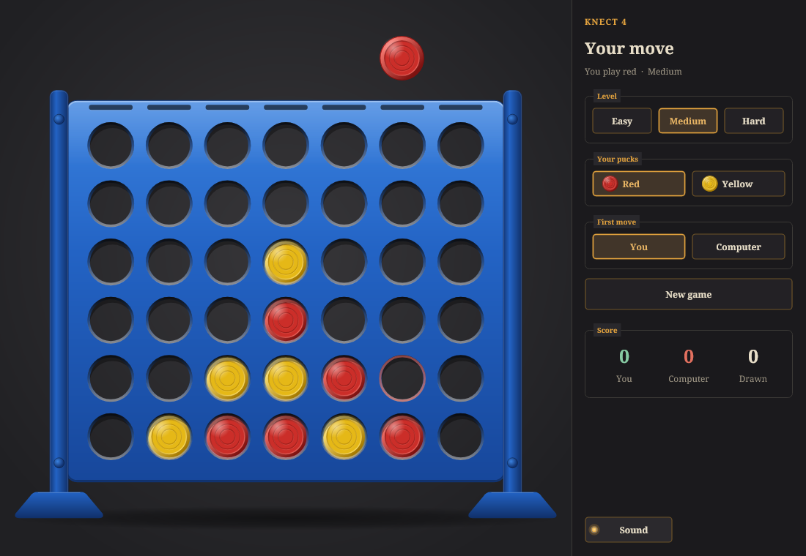

# knect4

Knect 4, against the computer or between two people at one board: drop pucks into a blue upright board, four in a row
across, up or diagonally wins.
A C++20 program with its window drawn in Skia on reckless-toolkit, in the Reckless apps' look.



## Playing

- Move the pointer over a column and your puck hangs above it, with its landing slot marked; click to drop it. The keys
  work too: 1 to 7 drop into a column, the left and right arrows move the puck, and Return, space or the down arrow
  drop it.
- The puck falls behind the frame, showing through the holes as it passes, lands with a click and bounces once or twice.
  The computer's puck sways above the board while it thinks, then glides to its column and drops.
- The panel beside the board sets who you play against (the computer or a friend), the level (Easy, Medium, Hard),
  your colour (red or yellow; the computer takes the other), who starts the next game, and the sound, and keeps the
  score. "New game" starts again; when a game ends the winning line glows and "Play again" appears over the board. The
  Game menu has all of these, with Ctrl+N for a new game, Ctrl+1 to Ctrl+3 for the levels, Ctrl+Shift+2 for a game
  against a friend and Ctrl+M for the sound.
- Against a friend, two people share the board and the mouse: Red and Yellow take turns, the held puck in the colour of
  whoever is to move, and the panel names them - "Red to move", "Yellow wins!". "First move" chooses Red or Yellow;
  the level and the colour choice are the computer game's and rest dimmed. Changing the opponent starts a new game, and
  games between two people keep a Red / Yellow / Drawn score of their own.
- The opponent, level, colour, who starts and the sound are kept between launches, in
  `reckless-technology/knect4/settings.json` in the user's settings folder (`%APPDATA%` on Windows,
  `~/Library/Application Support` on macOS, `~/.config` on Linux). The scores are the session's own.

## The game

`src/game` is the game of 2014's C# version (`Game.cs`, in this repository's history) in C++, unchanged in what it
does: the board (7 columns by 6 rows, the computer the MAX side), each move scored by the lines it stands in (1, 13, 37
and 104729 for lines of one to four), and a negamax search with alpha-beta pruning to a fixed depth - 3, 7 or 11 plies
for Easy, Medium and Hard - its moves tried best first. Its moves of equal score are ordered as the .NET Framework's
`List.Sort` left them, so it chooses among equal moves as the original did. `tests/data/csharp_self_play.txt` is 49
games the original played against itself at depths 1 to 7, recorded from the C# build; the suite replays every one and
requires the same move and the same score at every turn. Hard thinks for at most about a fifth of a second a move.

## The feel

`src/effects` holds what a drop feels like, written against no toolkit:

- `DropMotion`: the puck falls under gravity from where it was held, hits what it lands on, rises again at a fifth of
  the speed, and comes to rest once a bounce is too slow to rise from, each hit reported with its speed.
- `RenderClick`: the click, made from nothing at the output's rate - a burst of noise a fraction of a millisecond long,
  the puck's own ringing a few kilohertz up, and the board's lower knock beneath (deeper on the base than on another
  puck) - gone in about a tenth of a second, a little different for each seed.
- `ClickMixer`: the clicks played on the audio thread, asked for from the window's through a fixed queue with no lock.

The window plays them through the toolkit's audio device layer on the system's default output (`ClickPlayer`), each
landing louder the further the puck fell; where no output opens, the game plays on in silence.

## Building

On Windows, in Visual Studio's developer environment (`VsDevCmd.bat -arch=x64 -host_arch=x64 -no_logo`), with CMake and
Ninja:

```
git submodule update --init                      # the toolkit, external/reckless-toolkit (private)
cmake --preset release && cmake --build --preset release && ctest --preset release
build/release/src/app/Knect4.exe
```

`-DKNECT4_GUI=OFF` builds the game and its suites alone, with no submodule. VS Code's default build task builds the
Debug configuration, its test task runs the suites, and the "Knect 4" launch entry starts it under the debugger.

- `build/release/src/app/knect4_render <out.png> [mid|drop|won|lost|empty|friend|friend-won]` draws the window in that
  state to a PNG, and `knect4_render <out.png> icon <size>` the icon; `docs/images/` holds its pictures. The suites run
  it for every state.
- `powershell -ExecutionPolicy Bypass -File tools\coverage-windows.ps1` measures the line coverage of `src/` (clang-cl
  and LLVM's source-based coverage, the `coverage-windows` preset) over every suite, the window's launch and the render
  tool's runs, and fails under 95 %; `src/app/main.cpp`, which opens the window and the event loop, is left out.
- `python tools/make_icon.py build/release/src/app/knect4_render.exe` draws the icon at every size into
  `assets/icon/` (Pillow); the build takes them from there and needs no Python.
- C++ is formatted with clang-format 22.1.8 (`.clang-format`), which the pre-commit hook and CI check. In a fresh clone:
  `git config core.hooksPath .githooks`.

## CI

`.github/workflows/build.yml`, on the organisation's self-hosted runners (the repository is private): Windows with MSVC
builds everything, runs every suite including the window's launch, and keeps `Knect4.exe` as the run's artifact
`knect4-windows` for 30 days; a Linux job builds it with gcc instrumented for coverage, runs every suite and the
render tool's pictures, and fails under 95 % of lines (gcovr 8.3; the report kept as `knect4-coverage`) - the game's
Linux build; another checks the formatting. A newer push to a pull request cancels its older run; every commit on
`main` keeps its own. The toolkit submodule is read through its read-only deploy key, the secret
`RECKLESS_TOOLKIT_DEPLOY_KEY`. macOS is not built yet.

## History

The game began in 2014 in C# with Windows Forms, in the `software` repository under `ConnectFour/`, and was extracted
with its history by git-filter-repo. Its C# sources are in this repository's history up to the commit that replaced them
with the C++ port.
